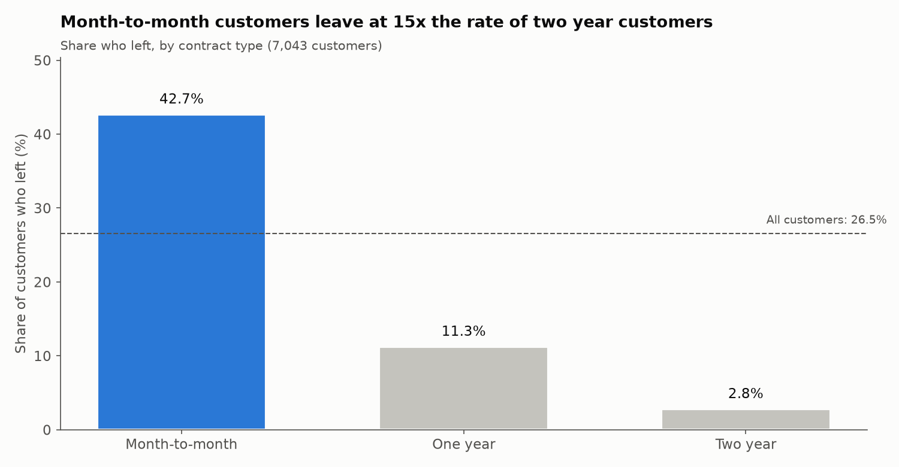
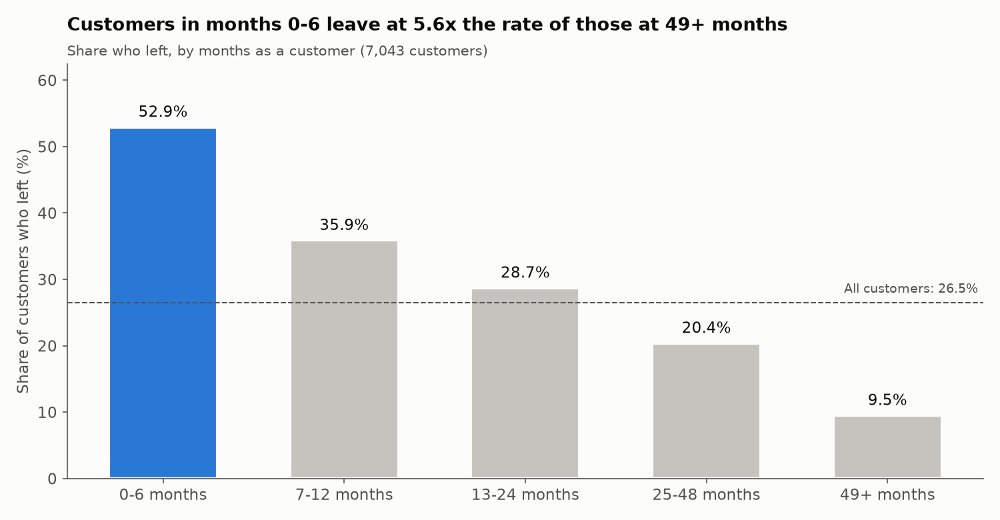
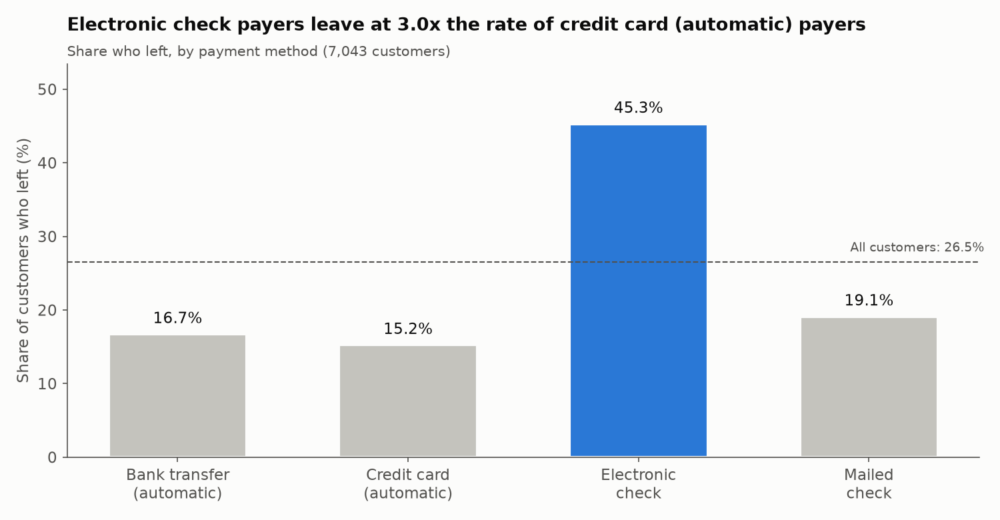
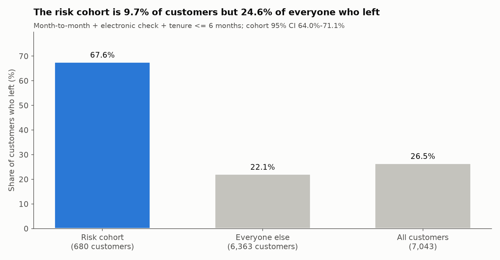
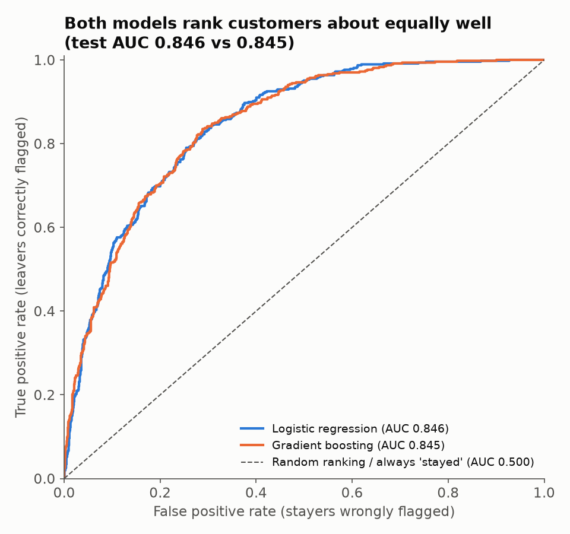

# Customer Attrition Analysis: IBM Telco Customer Churn

An end-to-end look at which telecom customers leave, how concentrated that risk is, and what a business
could test to keep more of them. Every number below is produced by the code in this repo. Run
`python src/verify.py` to check them.

## Business question
Which customers are most likely to leave? Is there a small, targetable group that accounts for a large
share of the customers who left? What should we test to reduce it?

## Data
[IBM Telco Customer Churn](https://github.com/IBM/telco-customer-churn-on-icp4d), a fictional sample
dataset: **7,043 customers, 21 columns**. It covers demographics, services, contract, billing, and `Churn`
(whether the customer left). **26.54%** of customers left.

**Data quality fix:** `TotalCharges` is stored as text, and null checks report 0 missing values. But
**11 values are blank strings**, and all 11 belong to customers with **tenure = 0**: they signed up but
hadn't been billed yet. We fill them with **0** (their true total billed) and keep every row.

## Method
1. **Audit**: types, missing values, the hidden TotalCharges blanks, duplicate IDs (none), and the
   category values. "No internet service" lines up exactly with customers who have no internet, so it isn't an error.
2. **Segments**: churn rate by contract, payment method, internet service and tenure band, with a
   chi-square test and Cramér's V to rank how strong each link is.
3. **Risk cohort**: month-to-month + electronic check + tenure ≤ 6 months, with a 95% Wilson confidence interval.
4. **Modeling**: one-hot encoding (`drop_first=True`) of all columns except `customerID` and `Churn`, a
   stratified 75/25 split (`random_state=42`), logistic regression (scaled) vs. gradient boosting, test
   AUC, and 5-fold stratified cross-validation.

## Key findings
1. **Contract type has the strongest link to leaving (Cramér's V 0.410).** Month-to-month customers left
   at 42.71%, against 2.83% on two-year contracts. Tenure is next (V 0.363): 52.94% of customers in their
   first 0-6 months left, against 9.51% at 49+ months.
2. **One small cohort holds a quarter of the customers who left.** Customers on month-to-month contracts,
   paying by electronic check, in their first 6 months: **680 customers (9.65% of the base), 67.65% churn
   rate (95% Wilson CI 64.0%-71.1%), 24.61% of all customers who left.** Everyone else churns at 22.14%.
3. **A simple model ranks risk well.** Test AUC is **0.846 for logistic regression and 0.845 for gradient
   boosting**. 5-fold CV gives 0.845 ± 0.013 and 0.847 ± 0.011. For reference, always predicting
   "stayed" is 73.46% accurate but has AUC 0.5: it can't rank anyone.

| | |
|---|---|
|  |  |
|  |  |



## Recommendation (proposed, not implemented)
- **Model choice:** logistic regression. It matches gradient boosting on AUC, and it's simpler to
  explain, audit and run.
- **Who to target:** the risk cohort above.
- **What to test:** (a) a first-90-day retention offer, such as an onboarding check-in plus a modest bill
  credit, and (b) an incentive to switch from month-to-month to an annual contract.
- **How to measure:** a randomized pilot. New cohort customers are randomly split into treatment and
  control, and the primary metric is **90-day churn, treatment vs control**. To detect a drop from 67.65%
  to 57.65% (a planning assumption) at 5% significance and 80% power, the pilot needs 367 customers per group.
- **Guardrails:** offer cost per treated customer must stay below the margin it saves (churn reduction ×
  monthly margin × extra months retained). Track gross margin, and watch for discounts going to customers
  who would have stayed anyway.

## Limitations
- **Association, not causation.** The cohort shows where leavers are concentrated, not why. Only the
  randomized pilot can show an offer works.
- **Snapshot data:** one point in time, no customer histories, no record of when or why people left.
- **No cost or margin data**, so the business case can't be put in dollars yet.
- **Fictional sample data** from IBM, so real-world rates would differ.
- **Overlapping features** (tenure, monthly and total charges) make individual coefficients hard to read
  in isolation (see notebook §4.7).

## How to run
```bash
git clone https://github.com/Alok270504/customer-attrition-analysis.git
cd customer-attrition-analysis
python3 -m venv .venv && source .venv/bin/activate
pip install -r requirements.txt
python src/audit.py      # Phase 1 data audit
python src/model.py      # baseline, models, cross-validation, coefficients
python src/charts.py     # regenerates outputs/charts/*.png
python src/verify.py     # expected vs actual for every headline number
jupyter notebook notebooks/attrition.ipynb
```
Built with Python 3.12. The code loads `WA_Fn-UseC_-Telco-Customer-Churn.csv` from the project root if
it's there; otherwise it uses `data/telco_churn.csv`.

## Repo layout
```
data/telco_churn.csv        raw data (IBM)
notebooks/attrition.ipynb   the full analysis, explained step by step
src/data.py                 loading and the single cleaning rule
src/audit.py                data audit
src/segments.py             churn by segment, chi-square, Cramér's V
src/cohort.py               risk cohort, Wilson CI, pilot sample size
src/model.py                baseline, logistic regression, gradient boosting, CV
src/charts.py               the five charts
src/verify.py               expected-vs-actual check of every headline number
INTERVIEW_PREP.md           likely interview questions with honest answers
```

## Future work
- **Uplift modeling**: target the customers an offer would actually change, not just the ones at highest risk.
- **Survival analysis**: model *when* customers leave, not just whether.
- **SHAP explanations**: per-customer reasons for the gradient boosting score.
- **CLV-weighted risk**: rank by expected revenue lost, not just churn probability.
- **Live risk-score dashboard**: score new customers weekly and feed the retention team.
